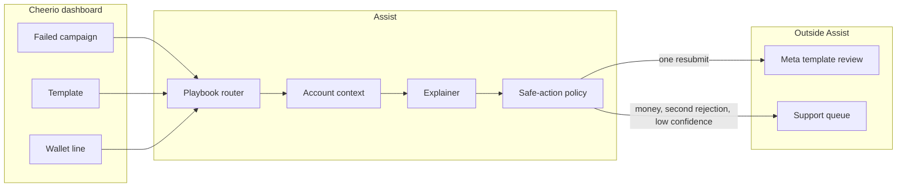
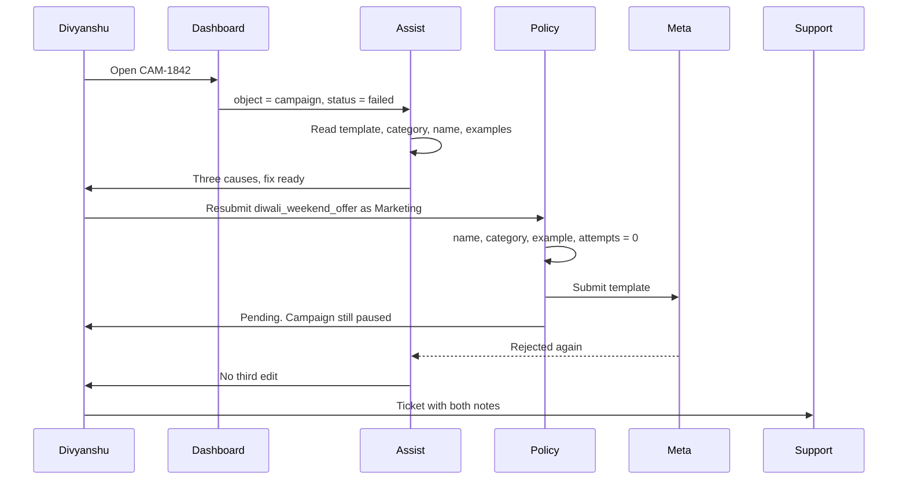

# Cheerio Assist

Divyanshu · Assignment A

Assist is the in-product fix for a failed Cheerio send. It reads the account, says what Meta rejected, prepares one safe edit, and hands the rest to a person with the facts already attached.

Live workspace: [cheerio-assist-hotel-amar.vercel.app](https://cheerio-assist-hotel-amar.vercel.app)

The path in that workspace is Hotel Amar, Growth plan, owner Divyanshu. Campaign `CAM-1842` (Diwali weekend rooms, 1,240 guests) failed because template `Diwali Offer` was rejected.

## Problem

Cheerio’s long tail is founders and marketers on Startup (₹1,999) and Growth (₹4,999). The help center already documents template names, WhatsApp onboarding, and workflow nodes. Tickets still get raised because the failure is sitting on a campaign, written in Meta’s language.

Enterprise accounts already have a manager. They are not the queue this is for.

## High-level architecture



Five pieces:

1. **Entry.** Assist opens on the object that failed: campaign, template, or wallet line. There is no blank chat to prompt.
2. **Account context.** A short read of live facts: template status, category, name, variable examples, last Meta note, delivery count, wallet line. The playbook text is cached. The live facts are not.
3. **Playbook router.** Picks one of seven issues. Each issue has a finish rate and a rule for what stays human. The router does not invent a new issue.
4. **Safe-action policy.** An allowlist. Rename to a valid slug, switch Marketing or Utility when the text and the category disagree, fill an example, resubmit once. Send, wallet, plan, and login changes are not on the list.
5. **Handoff.** A ticket with workspace, plan, object id, what was already tried, and what was not done. The person starts from that, not from an empty form.

## Low-level design

### Session

```text
session
  workspace_id, plan, actor
  object            campaign | template | wallet_line
  issue             one of the seven playbooks
  facts             the read from the account
  edits             proposed, not applied
  attempts          0 or 1
  outcome           pending_meta | handed_off | left_paused
```

A session is one object. Follow-up turns stay on that object. A second Meta rejection sets `attempts = 1` and closes the edit path.

### Playbooks

| Issue | What the check can finish | What stays with a person |
|---|---|---|
| Template rejected | Name format, Utility vs Marketing, missing example | A second rejection |
| WhatsApp setup stuck | Which step is still open | Facebook admin, number still on the WhatsApp app, verification hold |
| Workflow silent | Toggle, keyword, template not approved | Redesigning the flow |
| Campaign did not send | Status, usually the template | Unknown send errors |
| Why was I charged | Point at the debit | Refunds, credits, plan changes |
| Integration | Empty connection | The other company’s error |
| Other | Almost nothing | Bugs, access, one-off asks |

Checks run before the model writes a sentence. If a check fails, the button for that edit is disabled. The model does not get to talk the user into a bad resubmit.

### Safe-action gateway

```text
allow(action):
  action in {rename, set_category, set_example, resubmit}
  attempts == 0
  policy(action, facts) is true

deny:
  send_campaign, wallet_debit, wallet_credit, change_plan, change_login
```

`resubmit` calls Meta’s template review. It does not call the send API. The campaign stays paused until the owner sends it after approval.

### Explainer

Model: `gpt-4o-mini`.

| | Tokens | Price per 1M |
|---|---|---|
| Cached playbook + snapshot | 2,500 | $0.075 |
| Fresh input | 900 | $0.15 |
| Output | 450 | $0.60 |
| Follow-up on 20% of sessions | 600 in / 350 out | same input and output prices |

Prices from OpenAI’s API pricing page, checked 12 Oct 2026. Rupee assumption is ₹95.80 per dollar. A session is about ₹0.06. The operating cost that matters is the person who maintains the playbooks, not the tokens. Formulas are in `Cheerio-Assist-Cost-Model.xlsx`.

### Handoff payload

```text
ticket
  id, queue            Templates | Billing
  workspace, plan, actor
  object_id
  facts
  attempts
  assist_did
  assist_did_not       send, wallet, plan
```

Billing is a different queue from Templates. A charge question never lands on the template queue, and a rejected template never lands on billing unless the owner asked about a debit.

## Request path

The Diwali send, end to end:



Two other exits on the same object:

- Switching the category back to Utility fails the policy check. The resubmit control stays disabled.
- “Why was I charged ₹840?” reads wallet line `CAM-1790`. That debit is Monsoon rates, 1,188 delivered messages. `CAM-1842` is ₹0. The wallet API is not called. The ticket goes to Billing.

## What this quarter ships

| Month | Live | Adoption used in the model | Drop in human tickets |
|---|---|---|---|
| 1 | Template, campaign failed, charge question | 45% | ~12% |
| 2 | Above, plus WhatsApp setup | 60% | ~21% |
| 3 | Above, plus workflow, integration, other | 70% | ~34% |

North star is human tickets per 100 active businesses. On the blue inputs in the sheet that is about 111 today and about 74 in month 3. If month 1 is under about 10%, setup does not start. The first playbook gets fixed instead.

Charge questions are on the screen from month 1 and are counted at a 10% finish rate. A refund is not a resolution.

## Controls

- OpenAI invoice within 15% of logged tokens.
- Repeat contact within 7 days, by playbook. Over 12%, that playbook loses its button. The explanation can stay.
- 30 resolved sessions a week, read by the playbook owner. One wrong edit removes that button the same day.
- Automated check: Assist called no wallet, plan, or send endpoint.
- Headcount stays until tickets per 100 businesses actually move.

## Components

| Piece | Owns | Does not own |
|---|---|---|
| Dashboard | The failed row, the review form, the wallet line | Deciding whether an edit is safe |
| Playbook router | One issue, from the seven | Inventing an eighth issue from the model’s guess |
| Account read | Template status, category, name, examples, delivery count, the wallet line that was asked about | Writing back |
| Explainer | A short paragraph from the checks and the cached playbook | Enabling a button |
| Policy | Allow or deny before any write | The sentence the owner reads |
| Meta adapter | One template resubmit | The messages API |
| Ticket adapter | Templates queue or Billing queue | A reply to the owner |

The explainer and the policy are separate on purpose. A fluent paragraph cannot turn a denied action into an allowed one. If the model is down, the checks still render. The owner sees the three causes. They do not see a chat that is “thinking.”

## Records

```text
session
  id, workspace_id, plan, actor
  object_type, object_id
  issue
  facts_json          snapshot at open, not a live join on every sentence
  edits_json          proposed until the owner confirms
  attempts            0 or 1
  outcome             pending_meta | handed_off | left_paused
  opened_at, closed_at

playbook_version
  issue, version, text, finish_rule
  a resolved session keeps the version it used

token_log
  session_id
  cached_in, fresh_in, out
  compared to the OpenAI invoice, tolerance 15%

ticket
  id, queue, session_id
  payload             facts, attempts, what Assist did, what it refused
```

Follow-up turns stay on the same session and the same object. Opening a different campaign starts a different session. A wallet question on the same morning is a different issue and, if it is handed off, a different queue.

## Interfaces

The dashboard does not talk to Meta. It talks to Assist.

```text
POST /assist/sessions
  { object_type, object_id }
  -> { session_id, issue, facts, actions[], attempts }

POST /assist/sessions/:id/actions
  { action, fields }
  action in rename | set_category | set_example | resubmit | handoff | leave
```

`resubmit` is accepted only when `attempts` is 0 and the policy passes. The Meta call is the template-review API. The campaign send API is not on this client. `handoff` writes a ticket and sets the outcome. It does not wait for an agent to reply inside the product.

Reads that feed the session:

```text
templates.get(id)          status, category, name, components, last_rejection
campaigns.get(id)          audience size, status, template_id, delivered
wallet.line(id)            amount, campaign_id, delivered count
```

`wallet.line` is a read. Credit and debit are not methods on this service.

## What fails closed

| What happened | What the owner sees | What does not happen |
|---|---|---|
| Name, category, or example fails the check | The resubmit control stays disabled | A second copy of the bad template is filed |
| Meta times out on the first resubmit | The template stays pending | A duplicate submit |
| Meta rejects the resubmit | The edit path closes | A third version from Assist |
| The model times out or rambles | The check results, with no paragraph | A button flipping on because the paragraph said so |
| The owner asks about a debit | The matching wallet line, then a Billing ticket if they ask | A balance change |
| Repeat contact on that playbook crosses 12% | The explanation can stay | The button stays. It comes off the same week |

The campaign stays paused through every row above. Delivery stays 0 until the owner sends it, after Meta has approved the template, from the normal send screen. That screen is outside Assist.

## Repo

| Path | What it is |
|---|---|
| `prototype/index.html` | The clickable workspace |
| `doc/Cheerio-Assist-Assignment-A.pdf` | The written answer, 3 pages |
| `doc/Cheerio-Assist-Prompt-Log.pdf` | Prompts that changed the work, and the one that didn’t |
| `Cheerio-Assist-Cost-Model.xlsx` | Volume, cost, billing, roadmap, audit. Blue cells are inputs. The same workbook, shared with anyone who has the link: https://docs.google.com/spreadsheets/d/175zDen-vQv8dJx1no4NeMVFcEd0V_YPtqqi8Jti4Jvg/edit?usp=sharing |
| `model/build_cost_model.py` | Rebuilds the workbook |
| `screenshots/` | The four screens of the Diwali path |

Open `prototype/index.html` in a browser. No build step.

Author: Divyanshu
